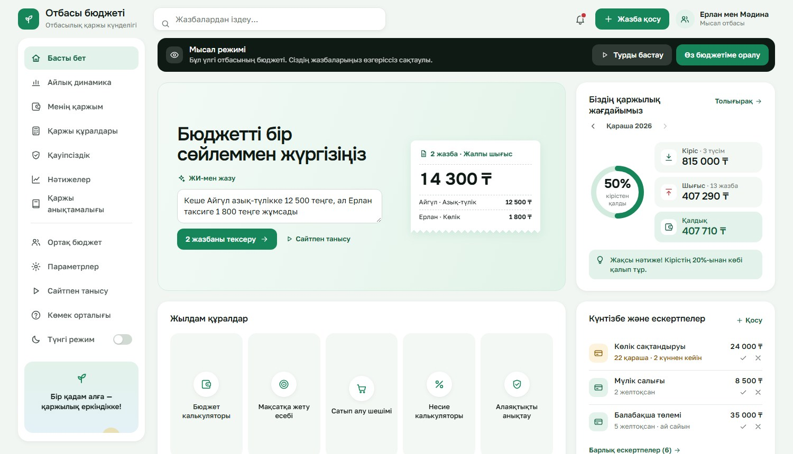
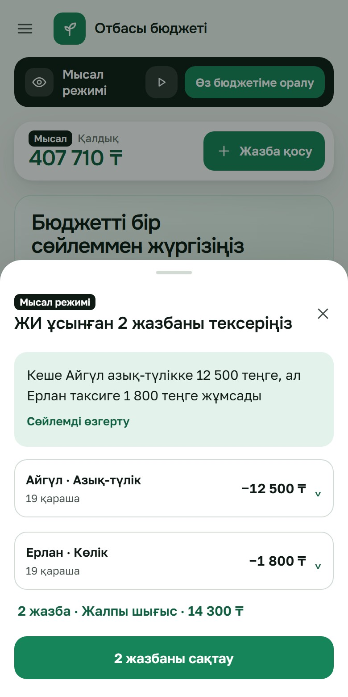
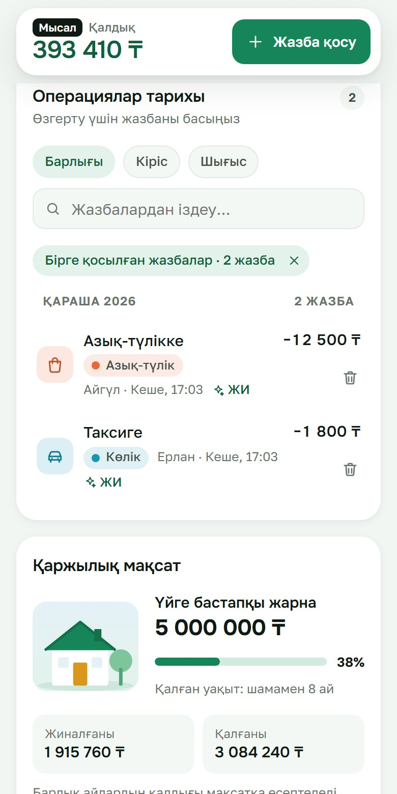

# Отбасы бюджеті

Отбасының кірісі мен шығысын теңгемен жүргізуге арналған қазақша веб-қосымша. Бір сөйлемге бірнеше төлемді жазыңыз. Жасанды интеллект (ЖИ) әр төлемнің сомасын, кім төлегенін және санатын ұсынады. Жазбаларды тексеріп сақтаған соң, әркімнің қанша жұмсағанын және ай соңына қанша ақша қалғанын көресіз.

[Сайтты ашу](https://foxfordkz-cyber.github.io/qarzhy/) · [Екі шығынды демода енгізу](https://foxfordkz-cyber.github.io/qarzhy/?demo=batch) · [61 секундтық демо-бейне](https://foxfordkz-cyber.github.io/qarzhy/competition/Otbasy-budget-demo.mp4)



## Бір сөйлемнен екі жазбаға дейін

> Кеше Айгүл азық-түлікке 12 500 теңге, ал Ерлан таксиге 1 800 теңге жұмсады.

1. Демоны ашыңыз. ЖИ «кеше» сөзін екі жазбаға да қолданады. Айгүлдің **12 500 ₸** шығыны «Азық-түлік», ал Ерланның **1 800 ₸** шығыны «Көлік» санатына кіреді.
2. Қажет болса, жолды түртіп, соманы, адамды, санатты немесе күнді түзетіңіз. **«2 жазбаны сақтау»** түймесін басыңыз.
3. **«Осы жазбаларды көру»** түймесі тарихтағы екі төлемді ашады. Жалпы шығын — **14 300 ₸**. Суреттерде оқу мысалы көрсетілген. [Демоны ашу](https://foxfordkz-cyber.github.io/qarzhy/?demo=batch)

<p>
  
  
</p>

*Телефондағы екі қадам. Алдымен ұсынылған жазбаларды тексересіз, содан кейін оларды тарихтан көресіз.*

## Тағы не істеп көруге болады?

- **Көмекшінің жауабын тексеріңіз.** Бір сатып алу мысалын сақтап, «Көмекшіден сұрау» түймесін басыңыз. Көмекші таңдалған айдағы соманы есептейді. Жауаптың астындағы сілтеме сол сомаға кірген жазбаларды көрсетеді. [Бір сатып алу мысалы](https://foxfordkz-cyber.github.io/qarzhy/?demo=ai)
- **Бюджетті екі телефонда жүргізіңіз.** «Жаңа бөлме ашу» түймесін басыңыз. Шақыру сілтемесін екінші құрылғыда ашып, «Бөлмеге қосылу» түймесін таңдаңыз. Жаңа бөлме бос болады. Бір құрылғыда қосылған жазба екіншісінде де көрінеді. Лимиттер, жинақ мақсаты және еске салғыштағы төлем белгілері де синхрондалады. [Ортақ бөлмені ашу](https://foxfordkz-cyber.github.io/qarzhy/?family=1)
- **Енгізу уақытын салыстырыңыз.** Сынақта үш оқу жазбасын қолмен, үшеуін ЖИ көмегімен енгізесіз. Басқа қойындыға ауысқанда таймер тоқтайды. Соңында уақытыңызды және қателер санын көресіз. Нәтижені жоба тобына жіберу — өз таңдауыңыз. [Сынақтан өту](https://foxfordkz-cyber.github.io/qarzhy/pilot/) · [Жалпы нәтижелер](https://foxfordkz-cyber.github.io/qarzhy/pilot/?results=1)

## ЖИ қалай жұмыс істейді?

Жобадағы қарапайым Байес жіктеуіші (Naive Bayes) **297 белгіленген мысалмен** браузерде үйретіледі. Ол сөздердің негіздері мен қатар тұрған үш таңбаға қарап, кірісті таниды және шығысты төрт санатқа бөледі. Бөлек ережелер сандарды, сөзбен жазылған сомаларды, күндерді және септік жалғауы бар есімдерді таниды. Бір сөйлемнен сегізге дейін жазба алуға болады. Төленген ақша мен қайтарылған ақша бірге көрсетілсе, қосымша нақты шығынды қолмен енгізуді сұрайды. [Модель мен талдау ережелері](js/ai.js)

Басты бетте мәтінді терген сайын алдын ала нәтиже жаңарады. «Жазба қосу» терезесінде сөйлемді теруге немесе браузер қолдаса, дауыстап айтуға болады. Модель санатқа сенімсіз болса, оны пайдаланушы таңдайды. Таныс сипаттамаға бұрын расталған санат ұсынылуы мүмкін. ЖИ көмегімен сақталған жолдардың тарихында «ЖИ» белгісі бар. [Қосымшаның коды](js/app.js)

**Gemini** жеке бюджетте бір жазбаны талдау немесе еркін қойылған сұраққа жауап беру үшін қосылады. «Параметрлер» → «Жасанды интеллект (Gemini)» бөлімінде өз Apps Script веб-қосымшаңыздың `/exec` деп аяқталатын толық сілтемесін енгізіп, «Сақтау және тексеру» түймесін басыңыз. Модель жауап берсе, «Проксимен байланыс бар» деген хабар шығады. API кілті Apps Script қасиеттерінде сақталады. Демо, ортақ бөлме және тарих бойынша нақты есептеулер құрылғыда жұмыс істейді. [Gemini қосу нұсқаулығы](apps-script/README.md) · [Тарих бойынша есептеу коды](js/budget-query.js)

## Модель сапасы

Модельді баптауға пайдаланылмаған 50 сипаттаманың **43-інде санат дұрыс анықталды (86%)**. Бөлек сынақтағы **28 сөйлемнің барлығында** жазба түрі, сома, адам және санат дұрыс шықты. Сенімділік шегі 0,60 болғанда, екі сынақ жиынындағы 150 мысалдың 94,7%-ы осы шектен өтті. Солардың 96,5%-ында санат дұрыс болды. [Бағалау скрипті](ai/eval.js) · [Толық нәтижелер мен қателер](ai/metrics.txt)

## Бюджет пен деректер

- Кіріс пен шығысты түзетуге, іздеуге және сүзуге болады. Ай қорытындысы, алты айлық график, санат лимиттері, жинақ мақсаттары, төлем еске салғыштары және калькуляторлар бар.
- Жеке бюджет браузерде сақталады. Демоның оқу жазбалары жадта ғана тұрады. CSV файлын жүктеп алуға және JSON сақтық көшірмесін жасауға болады.
- Ортақ бөлме деректерді серверге жіберер алдында құрылғыда AES-GCM арқылы шифрлайды. Шифрды ашу кілті шақыру сілтемесінің `#` таңбасынан кейін орналасады. Сілтеме иесі ортақ бюджетті оқи және өзгерте алады. Бұрын қосылған құрылғыда желісіз жасалған өзгерістер байланыс қалпына келгенде жіберіледі. [Шифрлау коды](js/family-room.js) · [Сервер мен дерекқор схемасы](service/)
- Gemini қосулы болса, Google прокси арқылы жеке сөйлемді немесе сұрақ пен бюджеттің жиынтық сандарын алады. Дауысты тану браузердің қызметіне байланысты. Сайт алғаш жүктеліп, кэшке сақталғаннан кейін жергілікті модельді интернетсіз де қолдануға болады.

## Өз құрылғыңызда іске қосу

Сайт HTML, CSS және JavaScript файлдарынан тұрады. Репозиторийдің түбірлік бумасында мына команданы орындап, демоны ашыңыз. [Жергілікті демо](http://127.0.0.1:8000/?demo=batch)

```sh
python -m http.server 8000 --bind 127.0.0.1
```

Модельді, синхрондауды, сынақты және сервердің API қызметін тексеру үшін Node.js 22.13 немесе одан жаңа нұсқасы қажет.

```sh
node --test
node ai/eval.js
```

GitHub Pages сайтты негізгі `claude/eloquent-cray-63d865` тармағының түбірінен жариялайды. Өз серверіңіз үшін D1 базасына `schema.sql` схемасын қолданып, базаны `worker.mjs` файлына `DB` атымен байланыстырыңыз. Серверде сайттың рұқсат етілген мекенжайын, ал клиентте API мекенжайын көрсетіңіз. [API өңдегіші](service/api.mjs) · [Дерекқор схемасы](service/schema.sql) · [Серверді іске қосу файлы](service/worker.mjs) · [Клиент баптауы](js/service-config.js)

## StartUp Battle — IT FEST 2026 материалдары

[Жоба таныстырылымы (PDF)](competition/Otbasy-budget-pitch.pdf) · [ЖИ картасы (PDF)](competition/ai-card.pdf) · [Бизнес-жоспар (PDF)](competition/business.pdf) · [Өтінім мәтіні және бейнепитч сценарийі](competition/application.md)

Демо-бейнеде қосымшаның жұмысы көрсетілген. Бейнепитчті команда мүшелері өздері жазады. Өтінім берер алдында белгіленген жерлерге қатысушылар туралы мәліметтерді, олардың үлесін және расталған нәтижелерді енгізіңіз. Баспа макетін жергілікті серверден Chrome немесе Edge браузерінде ашып, Ctrl+P арқылы PDF түрінде сақтауға болады. Масштабты 100% етіп, фондық графиканы қосыңыз және колонтитулдарды өшіріңіз. [12 слайдтың макеті](competition/deck/deck.html) · [ЖИ картасының макеті](competition/deck/ai-card.html) · [Бизнес-жоспар макеті](competition/deck/business.html)
