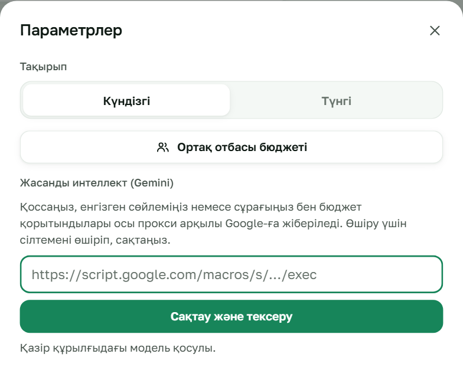

# Жеке бюджетке Gemini қосу

Қазақша және орысша жазбаларды негізгі модель құрылғыда талдайды. Жеке бюджетте бір жазбаны толтыру немесе еркін сұрақ қою үшін Gemini-ді қосуға болады. Баптау байланысты тексерген браузерде сақталады.

1. Google AI Studio жобасында Gemini API кілтін жасаңыз. [Кілттер беті](https://aistudio.google.com/apikey)
2. Google Apps Script ішінде жаңа жоба ашыңыз. `Code.gs` файлының мазмұнын репозиторийдегі кодпен ауыстырып, сақтаңыз. [Apps Script](https://script.google.com/home) · [Көшірілетін код](Code.gs)
3. Сол жақтағы тісті дөңгелекті басыңыз. Жоба баптауларынан **Script properties** бөлімін ашып, `GEMINI_API_KEY` қасиетін қосыңыз. **Value** өрісіне кілтіңізді енгізіп, сақтаңыз. Жобаңызда басқа модель қолданылса, оның атауын `GEMINI_MODEL` қасиетіне жазыңыз. Әдепкі модель — `gemini-3.1-flash-lite`. [Модель сипаттамасы](https://ai.google.dev/gemini-api/docs/models/gemini-3.1-flash-lite)
4. **Deploy → New deployment → Web app** тармағын таңдаңыз. Қосымшаны өз атыңыздан орындауды (**Me**) және барлығына қолжетімді етуді (**Anyone**) көрсетіңіз. Google сұраған рұқсаттарды растаңыз. Соңында `/exec` деп аяқталатын толық веб-мекенжайды көшіріңіз. [Apps Script веб-қосымшасын жариялау](https://developers.google.com/apps-script/guides/web)
5. Жеке бюджетте **«Параметрлер» → «Жасанды интеллект (Gemini)»** бөліміне өтіңіз. Веб-мекенжайды енгізіп, **«Сақтау және тексеру»** түймесін басыңыз. Сайт бюджет деректерінсіз сынақ сұрауын жібереді. Модель жауап бергенде **«Проксимен байланыс бар»** деген хабар мен модель атауы шығады. [Сайтты ашу](https://foxfordkz-cyber.github.io/qarzhy/)

*Сайттағы осы өріске Apps Script берген толық веб-мекенжайды енгізіңіз. API кілті жоғарыдағы үшінші қадамда Google жобасының қасиеттеріне жазылады.*

## Байланыс орнамаса

Сайт жауапты 30 секундқа дейін күтеді. Уақыт бітсе, тексеруді қайталаңыз. Қолжетімділік қатесі шықса, Google есептік жазбасына кірмей, жеке шолу терезесінде өзіңіздің `/exec` сілтемеңізді ашыңыз. Жарияланған скрипт `ok` және `model` мәндерін көрсетеді. Мұндағы `ok: true` кілт қасиеті толтырылғанын білдіреді. Сайттағы жасыл түйме модельге нақты сұрау жіберіп тексереді.

Модель табылмаса, `GEMINI_MODEL` мәнін жобаңызға қолжетімді модельдермен салыстырыңыз. Квота қатесі шықса, AI Studio жобасының лимиттерін тексеріңіз. Прокси бір жарияланымның барлық пайдаланушысына бірге минутына ең көбі 40 сұрау қабылдайды.

## Қандай деректер жіберіледі?

Бір жазбаны талдағанда прокси тек енгізілген сөйлемді жібереді. Еркін сұрақ қойылса, оның мәтінімен бірге таңдалған ай, кіріс, шығыс, қалдық, санаттар бойынша сомалар, жиналған қаражат және бар болса жинақ мақсатының сомасы жіберіледі. Тарих бойынша нақты есептеулер, демодағы және отбасылық бөлмедегі мәтін талдауы құрылғыда орындалады.

API кілті Apps Script ішінде қолданылады. Толық `/exec` сілтемесі арқылы проксиге сұрау жіберіп, оның квотасын пайдалануға болады. Gemini-ді ажырату үшін сайт баптауындағы сілтемені өшіріп, «Сақтау және тексеру» түймесін басыңыз.
